

  

  
  
  
  
  

# StudyHub SA

> **One app for everything a South African student needs to study together.**

**Author:** Makhadzi Rachel Mambani

**Backend repository:** [RayMambani/studyhub-sa-backend](https://github.com/RayMambani/studyhub-sa-backend) | **Live API:** https://studyhub-sa-backend.onrender.com

---

## Contents

1. [Purpose of the app](#1-purpose-of-the-app)
2. [Screenshots](#2-screenshots)
3. [Features](#3-features)
4. [Design considerations](#4-design-considerations)
5. [Architecture and technology](#5-architecture-and-technology)
6. [GitHub and GitHub Actions](#6-github-and-github-actions)
7. [Getting started](#7-getting-started)
8. [Release notes](#8-release-notes)
9. [Limitations and future work](#9-limitations-and-future-work)

---

## 1. Purpose of the app

### Why I built it

When I looked at how students around me actually study, I saw the same pattern: assignments in Google Classroom, notes in Google Drive, group chats in WhatsApp, deadlines in a phone calendar, and links lost somewhere between all four. Things fall through the cracks. In South Africa the problem is worse, because mobile data is expensive, connections drop during load-shedding, and students work in many home languages.

**StudyHub SA puts the whole study routine in one mobile app**, built around the South African context.

### What it does

StudyHub SA is a mobile learning and collaboration platform for college and university students. Students can:

- share and download study resources for each module
- join study groups and chat with classmates
- track tests, assignments and personal reminders in an academic calendar
- keep personal notes that work with no internet and sync later
- get AI help with summaries, questions and study tips
- earn points, badges and a daily streak for staying active

### Who it is for

University students, college students, distance-learning students, tutors and student mentors.

### Goals

| Goal | How the app meets it |
|---|---|
| Reduce app-hopping | Resources, groups, chat, calendar and notes in one place |
| Work in poor connectivity | Offline notes with automatic background sync |
| Reflect South African students | Three-language interface and local module examples |
| Keep students engaged | Points, badges and a daily streak |
| Be safe to use | Hashed passwords, token authentication, HTTPS only, account deletion |

---

## 2. Screenshots

<table>
  <tr>
    <td align="center" valign="top" width="25%">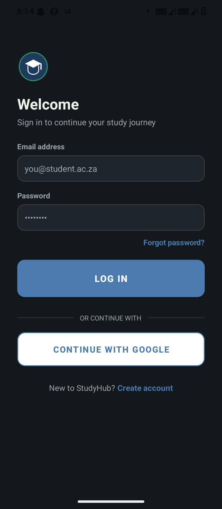 Login with Google single sign-on</td>
    <td align="center" valign="top" width="25%">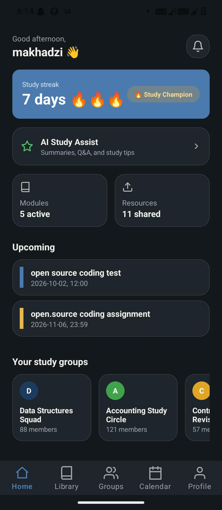 Dashboard with streak and upcoming events</td>
    <td align="center" valign="top" width="25%">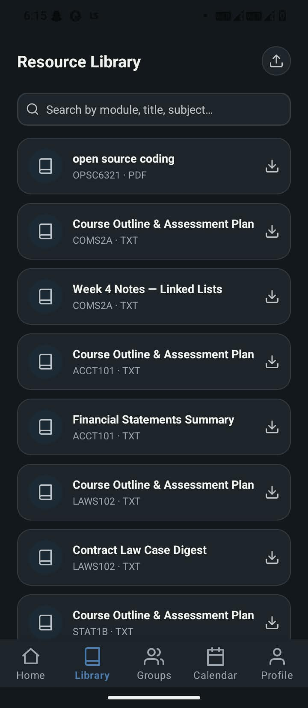 Study group chat</td>
    <td align="center" valign="top" width="25%">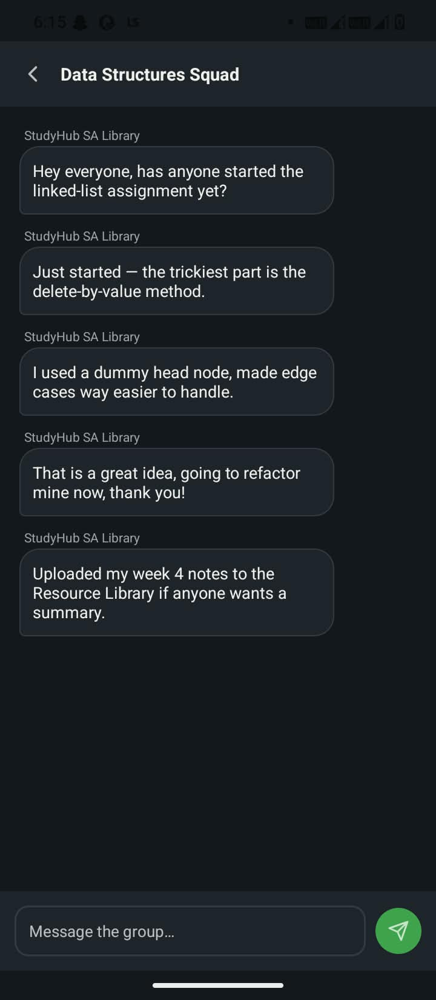 Academic calendar</td>
  </tr>
  <tr>
    <td align="center" valign="top" width="25%">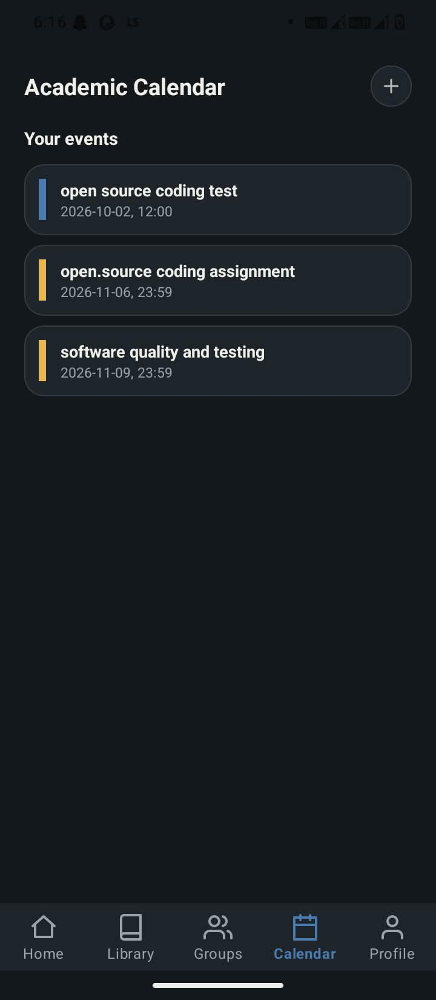 AI Study Assist</td>
    <td align="center" valign="top" width="25%">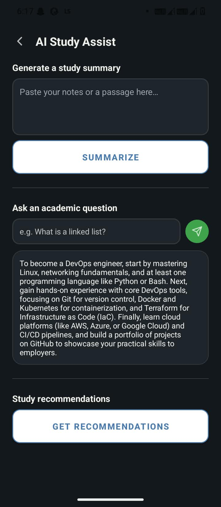 Profile, points and badges</td>
    <td align="center" valign="top" width="25%">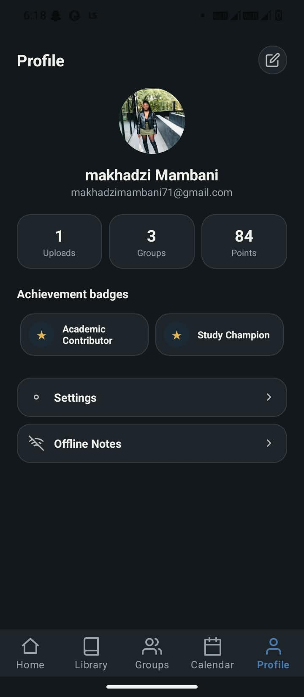 Settings in dark mode</td>
    <td align="center" valign="top" width="25%">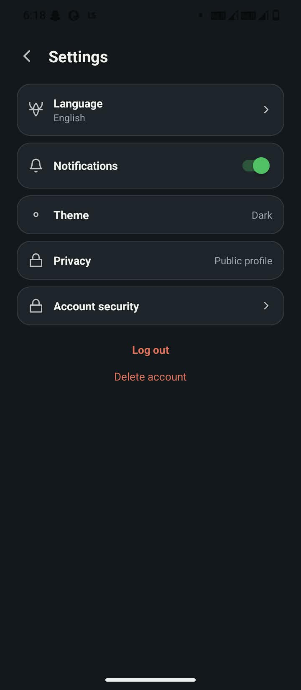 GitHub Actions run</td>
  </tr>
</table>

---

## 3. Features

### Core features

| Area | What is included |
|---|---|
| **Accounts** | Register and log in, bcrypt-hashed passwords, Google single sign-on, password strength rules, change password, delete account |
| **Resource Library** | Browse, search, upload, preview, download and comment on study resources by module |
| **Study Groups** | Join or create groups, group chat with real names, member counts |
| **Academic Calendar** | Add tests, assignments and reminders using date and time pickers |
| **Notifications** | In-app feed of new resources, messages, group joins and reminders |
| **Offline Notes** | Create, edit and read notes with no internet; automatic sync when back online |
| **Profile** | Profile picture, edit details, points, badges and streak |
| **Settings** | Language, light/dark/system theme, privacy, notifications, security |
| **Languages** | English, isiZulu, Tshivenda |

### Innovative features

| Feature | Summary |
|---|---|
| :trophy: **Gamification** | Points and four badges earned from real activity |
| :fire: **Study Streak Tracker** | Daily login streak with fire-emoji levels |
| :robot: **AI Study Assist** | Summaries, Q&A and recommendations powered by Google Gemini, with an automatic fallback |

The full explanation of each is in the [release notes](#8-release-notes).

---

## 4. Design considerations

### 4.1 Visual design

I designed all 14 screens as interactive HTML mockups first, then built them in Android. The look comes from the app's own icon: a graduation cap in a circle.

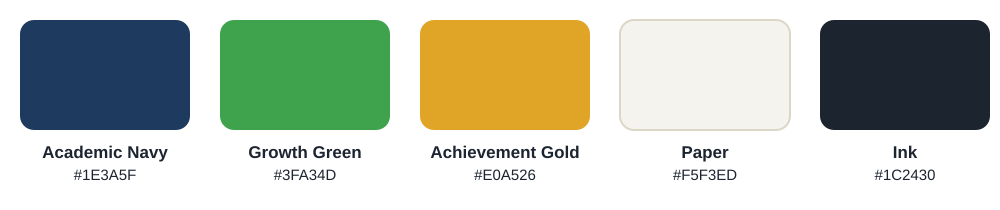

| Colour | Meaning |
|---|---|
| **Navy** | Trust and academic seriousness (the graduation cap) |
| **Green** | Growth and progress |
| **Gold** | Achievement, used for badges and deadlines |
| **Warm paper** | A soft background that is easier on the eyes than pure white |

A full dark theme is included, so students can study at night without eye strain. Every colour is a named resource, so the dark theme recolours the whole app from one file.

### 4.2 User experience

- **Bottom navigation** for the five main destinations (Home, Library, Groups, Calendar, Profile), so everything is one tap away.
- **Cards and clear grouping** so each screen shows one idea at a time.
- **Forgiving forms.** Invalid input produces a clear message instead of a crash, and the password rules are shown under the field before the student makes a mistake.
- **Native pickers** for dates, times and files, so students use controls they already know.
- **Honest loading behaviour.** The server runs on a free tier that sleeps, so timeouts are generous and error messages explain what happened.

### 4.3 Designing for South African students

| Reality | Design response |
|---|---|
| Data is expensive and connections drop | Offline notes with background sync; only needed data is fetched |
| Many home languages | Runtime language switching with full string translations |
| Students share old phones | Minimum SDK 24, no heavy animations |
| Study happens in groups | Group chat and shared resources are central, not an add-on |

### 4.4 Security by design

- Passwords are hashed with **bcrypt** (cost 12) on the server and never stored or returned in plain text.
- Sessions use **JWT** bearer tokens. The token is stored in **EncryptedSharedPreferences** (AES-256).
- The app only allows **HTTPS** traffic (cleartext is blocked except for the emulator's loopback address).
- Secrets (database token, API keys, signing keys) live in environment variables or ignored files and are **never committed**.
- Privacy controls let a student make their profile private, and they can delete their account and all their data from inside the app.

### 4.5 Design decisions and trade-offs

| Decision | Why | Trade-off |
|---|---|---|
| Native Kotlin app with a separate REST API | The brief asks for an API; separation lets the app and server change independently | Two codebases to maintain |
| Room (SQLite) on the phone | Reliable offline storage with a simple sync flag | Sync is one-way (phone to server) for notes |
| Turso (hosted SQLite) for the server database | Persistent and free, and keeps SQL I already know | Needed an async rewrite of the data layer |
| Cloudinary for uploaded files | Free hosting that survives server restarts | 10 MB file limit on the free plan |
| Chat refreshes every 4 seconds | Simple and reliable on a stateless API | Not truly instant like WebSockets |
| Gemini with a local fallback | Smart answers when possible, never a blank screen | Fallback answers are simpler |

---

## 5. Architecture and technology

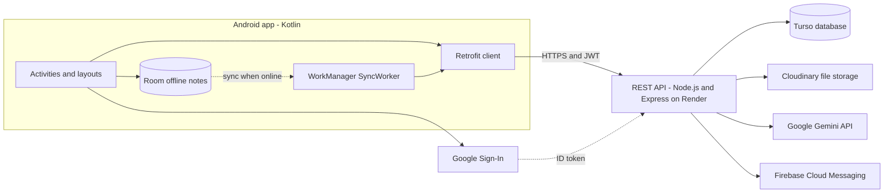

### Technology

| Layer | Technology |
|---|---|
| App | Kotlin, Android Views, Material Components |
| Networking | Retrofit 2, OkHttp, Gson |
| Local storage | Room (SQLite), EncryptedSharedPreferences |
| Background work | WorkManager |
| Images | Glide |
| Authentication | JWT, Google Sign-In (Firebase) |
| Backend | Node.js, Express |
| Database | Turso (libSQL / SQLite) |
| File storage | Cloudinary |
| AI | Google Gemini API |
| Hosting | Render (auto-deployed from GitHub) |
| Min / target SDK | 24 / 36 |

### REST API summary

| Area | Endpoints |
|---|---|
| Auth | `POST /api/auth/register`, `/login`, `/google` |
| Users | `GET /api/users/me`, `PATCH /settings`, `PATCH /profile`, `POST /avatar`, `POST /change-password`, `POST /delete-account` |
| Resources | `GET /api/resources`, `POST /api/resources`, `GET` and `POST /api/resources/:id/comments` |
| Groups | `GET` and `POST /api/groups`, `POST /:id/join`, `GET` and `POST /:id/messages` |
| Calendar | `GET`, `POST` and `DELETE /api/events` |
| Notifications | `GET`, `PATCH /:id/read` and `DELETE /api/notifications` |
| Offline sync | `GET /api/notes`, `POST /api/notes/sync` |
| AI | `POST /api/ai/summarize`, `POST /api/ai/ask`, `GET /api/ai/recommendations` |

Every endpoint except register, login and the public pages needs an `Authorization: Bearer <token>` header.

### Data stored

| Table | What it holds |
|---|---|
| `users` | Name, email, student number, bcrypt hash, language, privacy, streak, profile picture path |
| `resources` | Title, module, file path and uploader (the files themselves are on Cloudinary) |
| `comments` | Comments on resources |
| `study_groups`, `group_members` | Groups and who belongs to them |
| `messages` | Group chat messages |
| `events` | Calendar events |
| `notifications` | In-app notification feed |
| `notes` | Offline notes after they have synced |

---

## 6. GitHub and GitHub Actions

### 6.1 How I use GitHub

| Repository | Contents | Used for |
|---|---|---|
| [StudyHubSA](https://github.com/RayMambani/StudyHubSA) (this repo) | The Android app | Version control, CI build and tests, documentation |
| [studyhub-sa-backend](https://github.com/RayMambani/studyhub-sa-backend) | The Node.js REST API | Version control, CI tests, and automatic deployment to Render |

Good practice I followed:

- **Small, descriptive commits** such as "Fix case-sensitive email causing login failures", "Move database from local SQLite file to Turso" and "Add Gradle wrapper and Android CI pipeline", so the history reads like a changelog.
- **`.gitignore` keeps secrets out of the repos:** `.env`, signing keys (`*.jks`, `keystore.properties`), `local.properties` and the SQLite files are never committed.
- **Merging with the remote** (`git pull`, then push) when the remote had changes I did not have locally.
- **GitHub as the deployment trigger.** Pushing the backend repo makes Render rebuild and redeploy the live API automatically.

### 6.2 The CI/CD pipeline

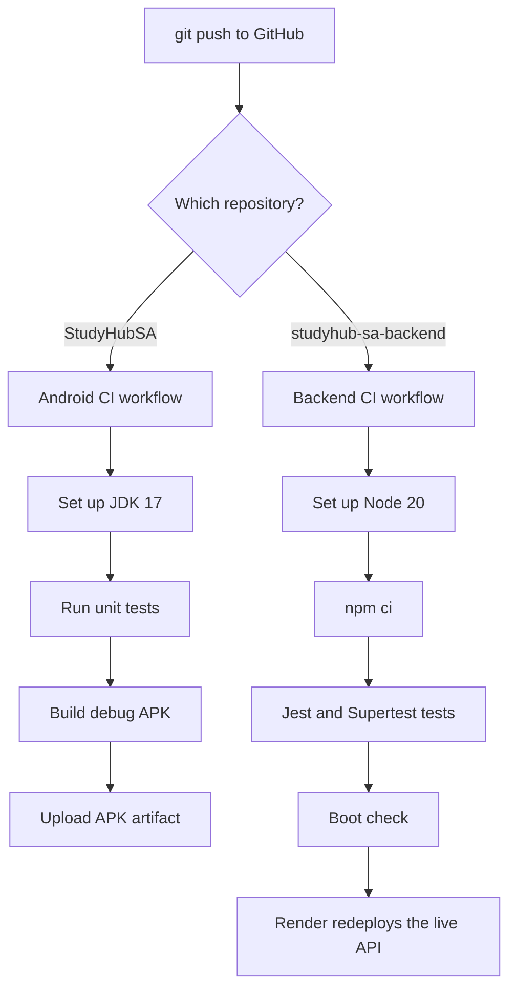

### 6.3 Android workflow (`.github/workflows/android-ci.yml`)

Runs on every push and pull request. It uses a clean Linux machine, so it proves the app builds on a computer that is **not mine**.

1. Check out the code
2. Set up JDK 17
3. Run the unit tests (`./gradlew testDebugUnitTest`)
4. Build the debug APK (`./gradlew assembleDebug`)
5. Upload the APK as a downloadable artifact

### 6.4 Backend workflow (`.github/workflows/backend-ci.yml`, in the backend repo)

1. Check out the code and set up Node 20
2. Install exact dependencies with `npm ci`
3. Run the automated tests with Jest and Supertest
4. Start the server and check that it answers

### 6.5 Automated testing

| Suite | Where | What it checks |
|---|---|---|
| Password rules (unit) | Backend, `util/password.test.js` | Rejects short passwords and ones missing an uppercase letter, number or symbol; accepts a strong one |
| Auth and API (integration) | Backend, `tests/auth.test.js` | Registration, rejecting weak passwords, case-insensitive login, wrong-password rejection, and the seeded study groups loading |
| Password rules (unit) | This repo, `PasswordValidatorTest.kt` | The same five rules, enforced in the app before a request is sent |

The backend tests run against a throwaway local database, never the live one.

To see the results, open the **Actions** tab of either repository. Every run shows each step with a green tick or a red cross, and the Android run offers the built APK for download.

---

## 7. Getting started

1. **Clone** this repository and open it in Android Studio.
2. **Firebase:** download your own `google-services.json` for the package `com.studyhub.sa` and place it in `app/`.
3. **Google Sign-In:** set `default_web_client_id` in `app/src/main/res/values/strings.xml` to your OAuth web client ID.
4. **Backend URL:** in `app/build.gradle.kts`, set both `BASE_URL` values to your API (the live one is `https://studyhub-sa-backend.onrender.com/`).
5. **Sync Gradle and run.**

To run your own backend, see the [backend repository](https://github.com/RayMambani/studyhub-sa-backend). It needs these environment variables: `JWT_SECRET`, `TURSO_DATABASE_URL`, `TURSO_AUTH_TOKEN`, `GOOGLE_CLIENT_ID`, `GEMINI_API_KEY`, `CLOUDINARY_CLOUD_NAME`, `CLOUDINARY_API_KEY` and `CLOUDINARY_API_SECRET`.

---

## 8. Release notes

### Version 1.0.0 - Final PoE release (October 2026)

This release takes StudyHub SA from the Part 2 prototype to a complete, tested and store-ready app. The three innovative features from my design document are now built, the PoE-only requirements are in, the backend is hosted on persistent storage, and every push is built and tested automatically by GitHub Actions.

#### :star: Innovative features added in this version

| Feature | What it does | How it works |
|---|---|---|
| :trophy: **Gamification (points and badges)** | Students earn points and badges for contributing to the community. Points are shown on the Profile screen. | Points = 15 per resource uploaded + 10 per study group joined + 2 per chat message + 5 per streak day. Badges are calculated by the server from real activity, so they cannot be faked. |
| :fire: **Study Streak Tracker** | Rewards students for coming back every day. The Dashboard shows the streak with fire emojis. | The streak goes up once for each consecutive day a student logs in and resets after a missed day. One fire = 1-2 days, two fires = 3-6 days, three fires = 7 days or more. |
| :robot: **AI Study Assist** | Three tools in one screen: generate a study summary from pasted notes, ask any academic question, and get personalised study recommendations. | The server calls Google's Gemini API. It asks Google which models are currently available instead of hard-coding a name, and falls back to built-in logic if Gemini is unreachable, so the student always gets an answer. |

**Badges**

| Badge | How it is earned |
|---|---|
| Academic Contributor | Upload your first resource |
| Resource Specialist | Upload 5 resources |
| Best Collaborator | Join a study group and send at least 3 messages |
| Study Champion | Reach a 3-day login streak |

#### :white_check_mark: PoE requirements added

- **Single sign-on:** "Continue with Google". The app gets a Google ID token, and the server verifies it before creating or opening the account.
- **Offline mode with sync:** personal notes are written to a local Room (SQLite) database, so they work with no internet. A WorkManager job uploads anything unsynced as soon as the phone is back online. Notes can be opened, edited and deleted, and each shows a Synced or Pending sync status.
- **Notifications:** a live in-app notification feed (new resources, group messages, group joins, calendar reminders) with read and delete. The Firebase Cloud Messaging receiver and the server-side sender are implemented. Push delivery to the phone switches on once the Firebase service-account key is added to the server.
- **Multi-language support:** English, isiZulu and Tshivenda, switchable at runtime from Settings.

#### :sparkles: New features and screens since the prototype

- Academic calendar with real date and time pickers and test, assignment and personal event types. Events also appear under "Upcoming" on the Dashboard.
- Resource Library with a real document preview, downloads through Android's download manager, search, and per-resource comments.
- Study groups with seeded member counts, existing conversations and downloadable module documents. Chat shows each sender's real name.
- Profile picture upload, edit profile (name and student number), and real activity stats.
- Settings that all work: language, light, dark or system theme, public or private profile, change password, notifications on or off, and delete account.
- Dashboard cards for Modules, Resources and Study Groups open the matching screen. The greeting changes with the time of day. The login screen says "Welcome" for new users and "Welcome back" for returning ones.

#### :lock: Security and compliance

- Passwords are hashed with bcrypt. New passwords need 8 or more characters, an uppercase letter, a number and a symbol, checked both in the app and on the server.
- Email addresses are matched case-insensitively.
- The login token is stored in AES-256 EncryptedSharedPreferences. The app only talks to the server over HTTPS.
- Account deletion inside the app, plus a public deletion page, for Google Play policy.
- The temporary demo endpoint that exposed database rows was removed.
- Public home, privacy policy and terms pages are hosted on the API for the Google OAuth consent screen.

#### :building_construction: Reliability and infrastructure

- The database moved from a temporary file to **Turso**, so accounts and data survive restarts, sleeping and redeploys.
- Uploaded files and profile pictures moved to **Cloudinary**, so they survive restarts too.
- Starter documents are committed to the repository, so they are always available.
- Network timeouts were raised to cope with the free-tier server waking up.
- The server catches unexpected errors and returns a clear message instead of crashing.
- The app now targets **Android 16 (API 36)**, with edge-to-edge screen insets handled on every screen, as Google Play requires.

#### :wrench: Fixes

- Login failing with the correct password because of email capitalisation.
- Button text invisible on the Login and AI Study Assist screens.
- Raw JSON such as `{"error": "..."}` showing in error messages.
- Offline notes could not be opened after saving.
- The resource preview was blank.
- Chat showed internal IDs instead of names.
- AI Study Assist stopped answering when Google retired a model name.

#### :gear: Engineering and testing

- GitHub Actions now builds and tests the Android app and the backend on every push.
- Backend: 10 automated tests (Jest and Supertest). Android: 5 unit tests.
- Gradle wrapper added so the project builds on any machine, not only mine.
- Full documentation (this README).

#### :construction: Known issues in this release

- Push notifications are not delivered to the phone until the Firebase service-account key is added on the server.
- Group chat refreshes every 4 seconds rather than using a persistent connection.
- Uploads are limited to 10 MB, the Cloudinary free-plan limit.
- The first request after the free-tier server has been idle can take up to about 50 seconds.

### Prototype (Part 2) - baseline

Registration and login with hashed passwords, a settings screen, a REST API connected to a hosted database, and the first versions of the Part 1 screens.

---

## 9. Limitations and future work

- Weekly and monthly study goals (from my original design) are not built yet; the streak is daily only.
- Offline mode covers personal notes. Offline reading of downloaded resources and drafting messages offline are planned.
- Group chat should move to WebSockets for instant delivery.
- Push notification delivery needs the Firebase service-account key on the server.
- A "report content" and "block user" feature is planned before public release on Google Play.
- Translations should be reviewed by fluent speakers of each language.

---

## Acknowledgements

Built for the IIE Open Source Coding (S2) module. Thanks to the open-source libraries that make this possible: Retrofit, OkHttp, Room, WorkManager, Glide, Firebase, Express, Jest, Supertest and bcrypt.

Made in South Africa, for South African students.

